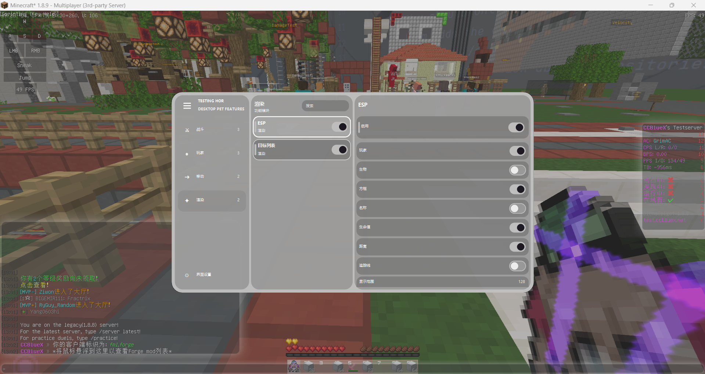
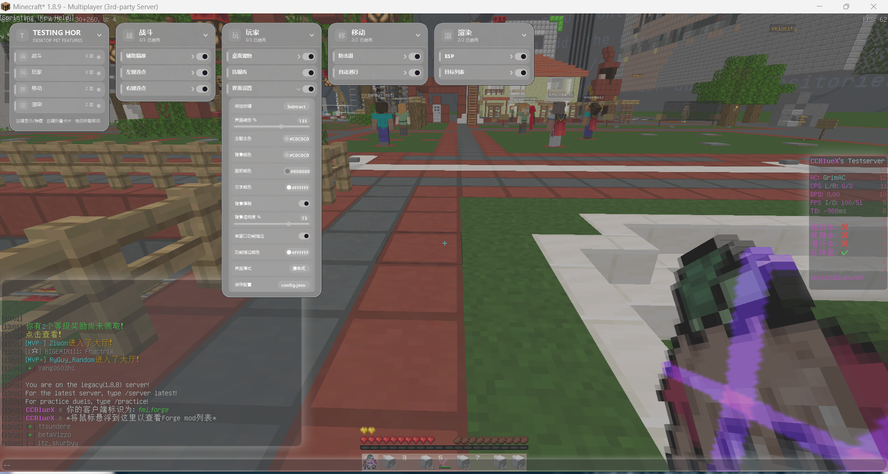
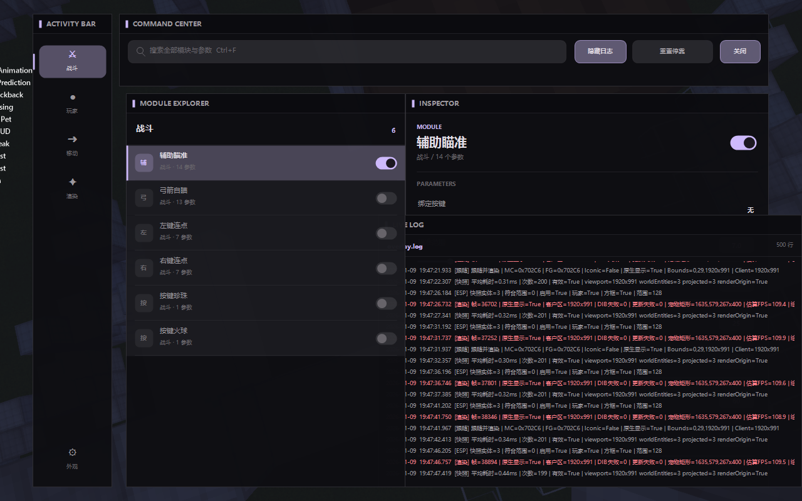
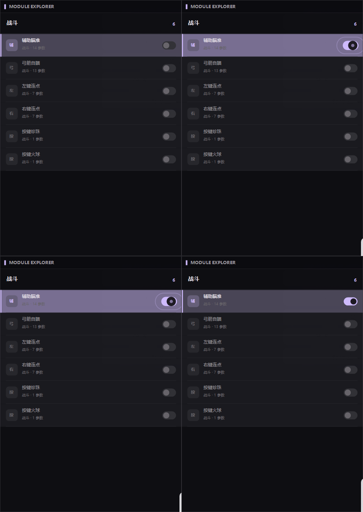
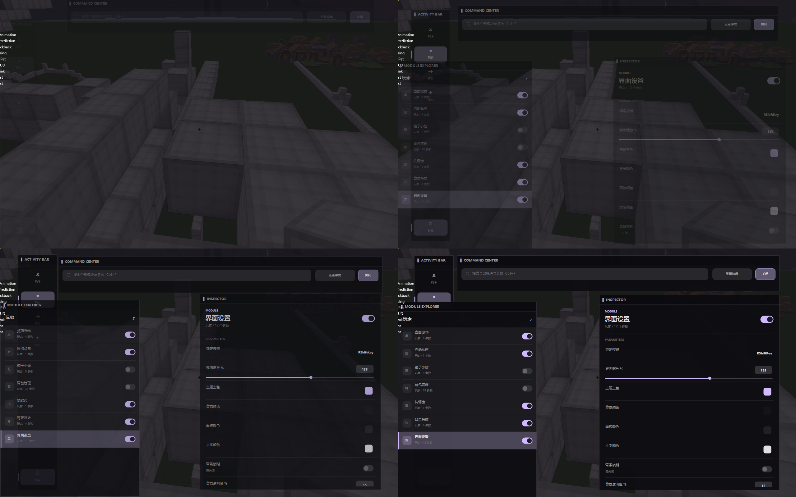
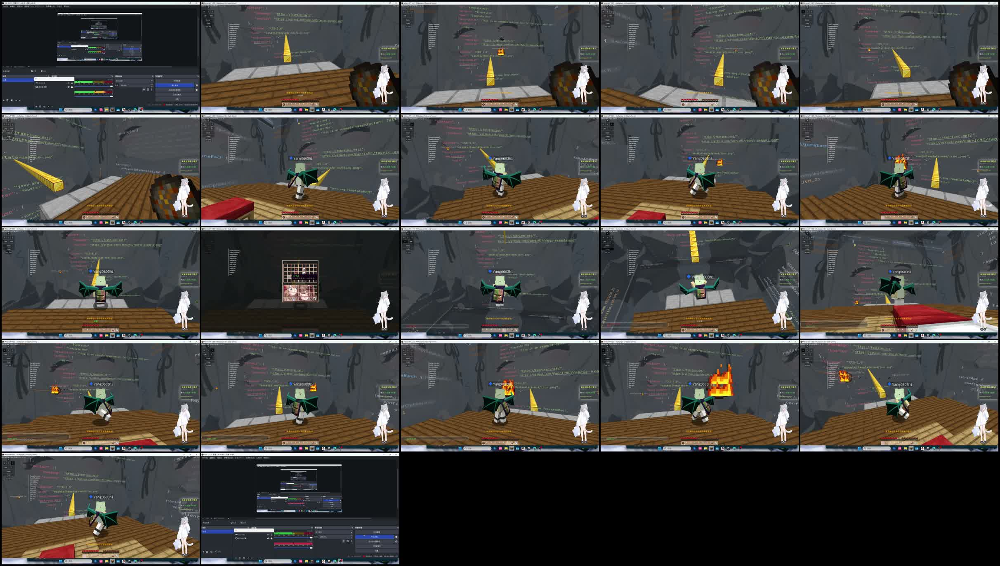
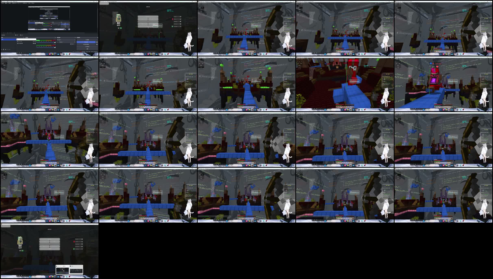
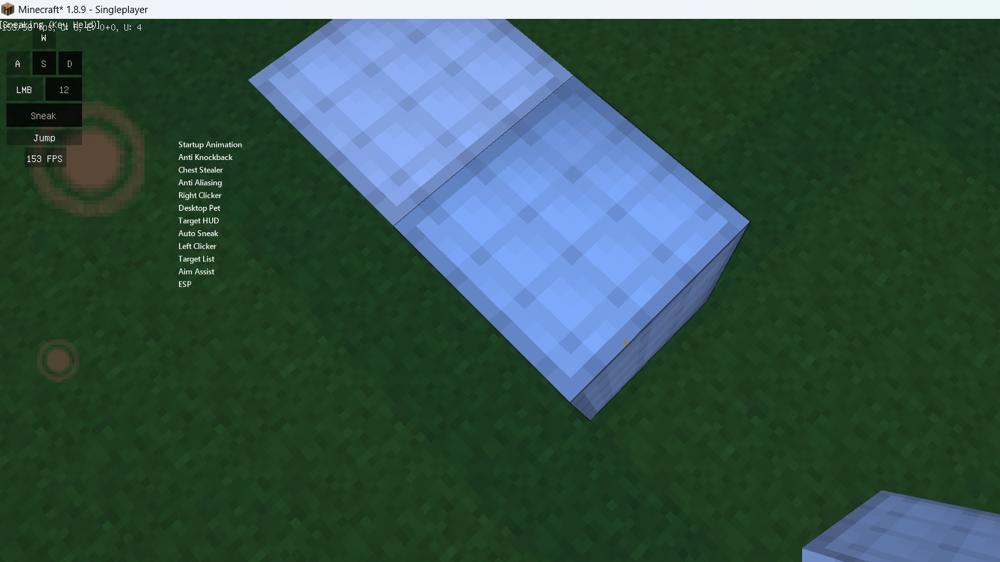

# McPetOverlay

> 面向 Minecraft Java 1.8.9 的 Windows 外部桌面宠物、只读状态可视化、HUD 与三模式设置工作台。

**原作者 / 当前发布账号：[`luxiuhaoDev`](AUTHORS.md)**  
**未经授权，禁止将本项目的官方名称、截图、视频、美术和官方发布包用于商业盈利、冒充官方或付费倒卖。** 源代码中 GPLv3 部分的商业分发边界见 [商业使用说明](COMMERCIAL_USE.md)。

#PS：真不我写的

[](.github/workflows/build.yml)

## 项目简介

McPetOverlay 是一个独立运行的 .NET 8 / WinForms Windows 程序。它跟随 Minecraft 窗口显示桌面宠物、ESP、目标 HUD、装备、床、火球/弓箭预测和模块状态；同时提供单窗口、瀑布式和多工具窗工作台三套设置界面。

程序不修改 Minecraft JAR，不需要安装 Forge/Fabric Mod，不向 Java 进程注入 DLL。状态数据通过 `OpenProcess` + `ReadProcessMemory` 只读采集，再由本地快照模型交给 GDI+ 分层窗口绘制。源码中没有 `WriteProcessMemory`、远程线程或内核驱动。

> 自动输入、瞄准和背包操作可能违反服务器规则。仅在单机、私人服务器、测试环境或明确允许的场景使用。本项目不提供反作弊规避教程，也不承诺“不可检测”或账号安全。

## 三套 UI

### 单窗口



分类、模块和参数在一个紧凑窗口中完成，适合小屏幕和快速设置。具备搜索、独立滚动、逻辑缩放、右键详情和动画开关。

### 瀑布式



每个分类是可拖动卡片，多组模块可同时展开，位置、显示和展开状态持久化，适合并行观察和自定义布局。

### 工作台



由命令/搜索、分类、模块、检查器和实时日志等独立工具窗组成。支持自由拖动、八方向缩放、边缘/窗口磁吸、阻尼弹簧动画、布局保存与日志跟随。

三套 UI 共用同一模块/设置模型，可即时切换，不会产生三份配置或功能分叉。详细原理与各自优势见：

- [三套 UI 原理](docs/architecture/ui-systems.md)
- [功能、UI 优势与方案对比](docs/FEATURES_AND_ADVANTAGES.md)

## 动画与功能演示

| 开关动画 | 工作台吸附/布局动画 |
| --- | --- |
|  |  |

| 火球轨迹 | 弓箭预测 | 箱子设置 |
| --- | --- | --- |
|  |  |  |

- [MP4 演示 1](docs/media/demo-1.mp4)
- [MP4 演示 2](docs/media/demo-2.mp4)
- [启动动画分镜](docs/images/animation-startup-frames.png)
- [ESP 运行画面](docs/images/esp-overlay.png)

## 核心功能

- 玩家/生物 ESP：方框、名称、距离、血条、追踪线、装备与过滤；
- 床/黑曜石 ESP；
- 火球实体轨迹、手持火球预览；
- 弓箭弹道预测、视线检查和锁定动画；
- 目标列表、目标 HUD、附近目标卡片、已启用模块列表；
- HUD 拖动编辑和位置持久化；
- 自动瞄准、弓箭瞄准、左右连点、快捷珍珠/火球；
- 边缘潜行、可配置击退节奏；
- 箱子管理、背包热栏规划、自动盔甲和物品保留/处理；
- 桌面宠物、启动动画、环境特效、自定义主题和模块热键；
- 三套 UI、工作台日志和诊断输出。

完整参数和优势：[功能、UI 优势与方案对比](docs/FEATURES_AND_ADVANTAGES.md)。

## 相比普通客户端/Mod 的优势

- 不改游戏目录，不依赖 Forge/Fabric 安装；
- 独立 .NET 进程，UI/日志与 Minecraft JVM 故障域分离；
- 内存路径只读、可搜索审计；
- 覆盖渲染与游戏渲染循环解耦；
- 工具窗可以放在游戏区域外，适合大屏调试；
- 三套 UI 服务不同信息密度和使用习惯；
- 自包含单文件发布，配置集中、回滚简单；
- 第三方参考、源码、产物节点和重建日志公开可查。

同时也存在 HotSpot 布局兼容、Windows 分层窗口、DPI、全屏和服务器规则等限制，详见 [安全边界与兼容性](docs/SECURITY_AND_COMPATIBILITY.md)。

## 内存读取方法

```text
查找 Minecraft Java 窗口
  -> OpenProcess(查询 + 只读)
  -> 校验 Java 主模块 MZ
  -> 定位 jvm.dll
  -> 解析 HotSpot VMStruct/VMType 导出
  -> 枚举已加载类并解析 Java 字段偏移
  -> 解码 compressed oops
  -> 读取 Minecraft/World/Player/RenderManager
  -> 构建实体、装备、床、火球、背包快照
  -> 交给渲染和功能层
```

完整说明：[只读内存读取链路](docs/architecture/memory-reading.md)。

## 渲染层原理

覆盖窗口跟随 Minecraft 客户区，使用透明、置顶、点击穿透的 layered window。每帧在本地 32 位 ARGB 离屏位图上用 GDI+ 绘制，再通过 `UpdateLayeredWindow` 一次提交。世界坐标通过游戏的模型视图矩阵、投影矩阵和 viewport 转换为屏幕坐标。

完整说明：[渲染层原理](docs/architecture/rendering.md)。

## “绕过”与安全边界

公开版不包含规避反作弊检测的方法。项目所说的兼容机制是：不改游戏文件、窗口点击穿透、不抢焦点、只读进程访问、数据失败降级和输入门控。任何服务器或平台是否允许使用，应由用户自行确认。

详细说明：[安全边界、兼容性与风险](docs/SECURITY_AND_COMPATIBILITY.md)。

## 架构

- [总体架构](docs/architecture/overview.md)
- [只读内存读取](docs/architecture/memory-reading.md)
- [GDI+/分层窗口渲染](docs/architecture/rendering.md)
- [三套 UI 原理](docs/architecture/ui-systems.md)

## 构建

要求 Windows x64 和 .NET 8 SDK：

```powershell
dotnet restore DesktopPet.csproj
dotnet build DesktopPet.csproj -c Release
dotnet publish DesktopPet.csproj -c Release -o publish/win-x64
```

详细步骤：[BUILDING.md](BUILDING.md)。

## 开发日志

本项目早期没有可完整恢复的 Git 历史，因此没有伪造提交记录。以下日志由源码文件时间、本地 `artifacts/publish-*`、测试目录和阶段备份重建：

- [项目前史与遗失历史](docs/history/PREHISTORY.md) — 解释为什么现存证据不是项目绝对起点；
- [逐日开发日志](docs/history/DAILY_LOG.md) — 现存证据覆盖 2026-11-01 至 2026-11-09；
- [逐版本开发日志](docs/history/VERSION_HISTORY.md) — 7 个早期发布痕迹 + 59 个命名构建/测试/整合节点；
- [原创性证据索引](docs/history/EVIDENCE_INDEX.md)；
- [可重复生成脚本](tools/Generate-ReconstructedHistory.ps1)。

11 月 6 日没有独立可核验节点，日志明确保留为空，而不是补写不存在的工作。原作者确认项目可能早于 11 月 1 日，但更早材料目前未找到，所以 README 不把 11 月 1 日写成绝对诞生日。

## 原创性与两次封禁经历

原作者说明：项目曾进行两次提交尝试，两次均因当时助手采用的提交方式问题，导致相关发布账号意外被封禁。当前由 `luxiuhaoDev` 重新整理完整仓库。两个历史账号名称、平台、准确日期和通知材料仍待作者补充。

- [完整经历与证据链](docs/ORIGINALITY_AND_RELEASE_HISTORY.md)
- [作者署名](AUTHORS.md)

针对骗取旧源码、开源圈钱或造谣者的控诉部分目前按作者要求留空，不代写未经核实的指控。

## 参考来源

已确认的主要参考：

- [NekoyaHouse/Epsilon](https://github.com/NekoyaHouse/Epsilon) — GPLv3，设置 UI 的视觉/交互参考；
- `Myau-Poorcatgirl-Fresh` — 原始本地声明记录为 GPLv3，ESP/HUD 视觉参考；精确上游 URL 尚待恢复；
- [OpenMyau](https://github.com/60124808866/OpenMyau) — 相关公开 GPLv3 谱系上下文，不冒充缺失的精确来源。

完整范围、许可证与实现区别：[参考来源](docs/REFERENCES.md) / [第三方声明](THIRD_PARTY_NOTICES.md)。

## 许可证与商业使用

- 程序源代码及 GPLv3 派生部分：GNU GPL v3，见 [LICENSE](LICENSE)；
- 必须保留作者与第三方声明；
- 原创品牌、官方身份、截图、视频、美术与官方发布包：未经 `luxiuhaoDev` 书面授权禁止商业盈利、付费倒卖或冒充官方；
- GPLv3 本身允许合规收费分发，因此不能对 GPL 覆盖代码追加全面非商业限制；具体分层见 [COMMERCIAL_USE.md](COMMERCIAL_USE.md)。

## 免责声明

本项目与 Mojang、Microsoft、Minecraft、Epsilon、Myau 或任何服务器运营方无隶属或背书关系。使用者自行承担兼容性、规则、账号和系统风险。
