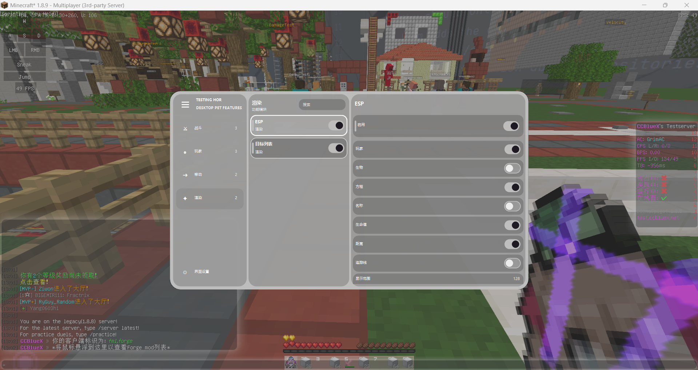
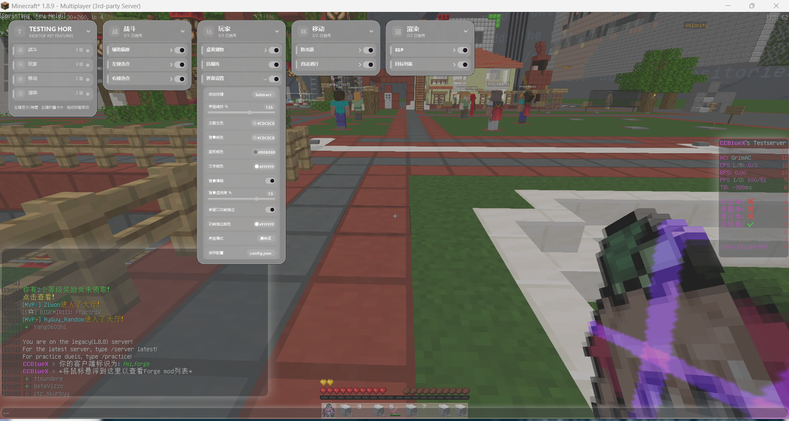
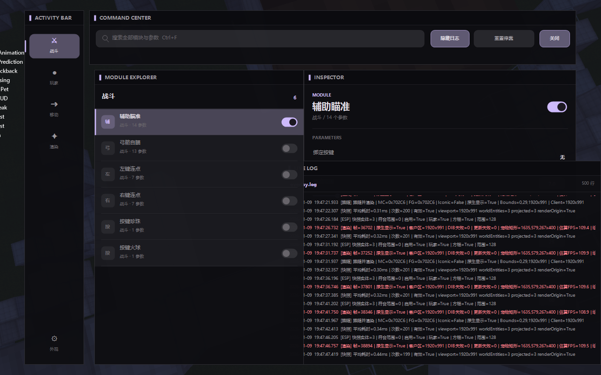
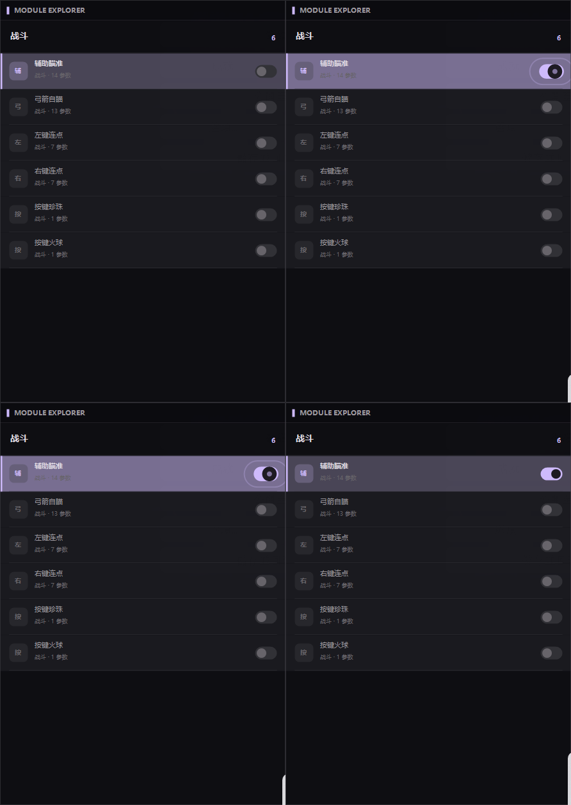
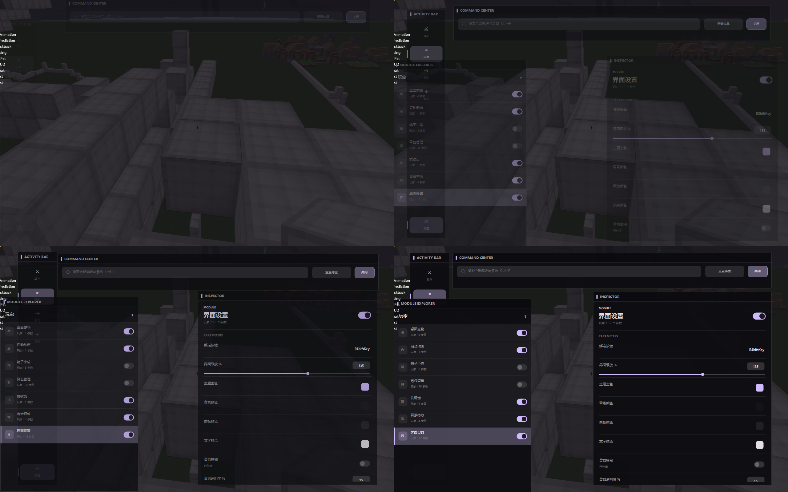

# 三套 UI 原理

三套界面不是三份独立功能代码。`SettingsForm` 先构造统一的模块与设置模型，再由三种视图分别渲染和处理交互。

## 共享模型

```text
EpsilonModuleModel
  ├─ Name / Category / HotkeyId
  ├─ EnabledGetter / EnabledSetter
  └─ Settings
       ├─ EpsilonBoolSettingModel
       ├─ EpsilonSliderSettingModel
       └─ EpsilonActionSettingModel
```

所有视图调用相同 getter/setter 和保存回调，因此切换 UI 不会丢失模块状态。`界面模式` 左键循环切换，右键打开三选一菜单。

## 1. 单窗口模式



实现：`UI/Controls/EpsilonPanelControls.cs`

布局由一个自绘控件完成：左侧分类栏、中间模块列表、右侧详情面板。

- `ComputeLayout` 根据 UI 缩放计算逻辑坐标；
- 鼠标坐标先转换到逻辑坐标，再命中分类、模块或设置；
- 搜索框过滤模块；
- 左侧栏可展开/折叠；
- 模块列表和详情区分别维护滚动值；
- 开关动画使用字典按设置对象保存进度；
- 滑块拖动期间持续更新配置；
- 右键模块打开详情，动作设置可定义独立右键动作。

适合希望在一个紧凑窗口中完成全部设置的用户。

## 2. 瀑布式模式



实现：`UI/Controls/EpsilonDropdownControls.cs`

每个分类是独立的卡片面板，面板包含标题栏、模块行和展开的设置井。

- 面板可拖动并保存 `X/Y`；
- 面板可以打开、关闭和独立滚动；
- 模块设置展开高度使用平滑进度插值；
- 内容高度超过屏幕时绘制自定义滚动条；
- 布局状态保存在 `DropdownPanels`；
- 模块展开状态保存在 `DropdownModuleExpanded`；
- 各面板共享主题、字体缓存和统一设置模型。

它适合同时观察多个分类，并把常用面板摆放在固定位置。

## 3. 工作台模式



实现：`UI/Forms/EpsilonWorkbenchCoordinator.cs`

工作台将设置拆成五类工具窗：命令/搜索、分类、模块、检查器和实时日志。每个工具窗都是独立无边框 WinForms 窗口，由协调器统一管理。

核心机制：

- 八方向缩放：`WM_NCHITTEST` 与自定义变换模式共同处理边缘/角落；
- 自由拖动：工具窗发送拖动开始、几何变化和拖动完成事件；
- 磁吸：`SnapBounds` 比较游戏边缘与其他工具窗边缘，进入阈值时吸附；
- 弹簧：`WindowMotion` 维护位置、大小和速度，以阻尼弹簧逐帧收敛；
- 布局保存：每个窗口记录归一化位置和实际尺寸；
- 实时日志：日志窗每 350 ms 检查文件变化，支持滚轮和跟随尾部；
- 模块动画：开关弹簧、点击脉冲与行闪烁组合；
- 键盘导航：共享 `WorkbenchState` 管理分类、搜索和当前模块。

工作台适合大屏幕、调试和需要同时查看日志/模块详情的场景。

## 主题系统

`EpsilonTheme` 从四个基础颜色产生完整色板：背景、面板、文本、强调色。高层表面、轮廓和次要颜色通过混色计算，因此三套 UI 在用户更换颜色后仍保持层级关系。

## 动画演示





- [演示视频 1](../media/demo-1.mp4)
- [演示视频 2](../media/demo-2.mp4)

GitHub 通常不会直接在 README 内自动播放 MP4，因此视频采用链接形式，静态分镜用于快速预览。
